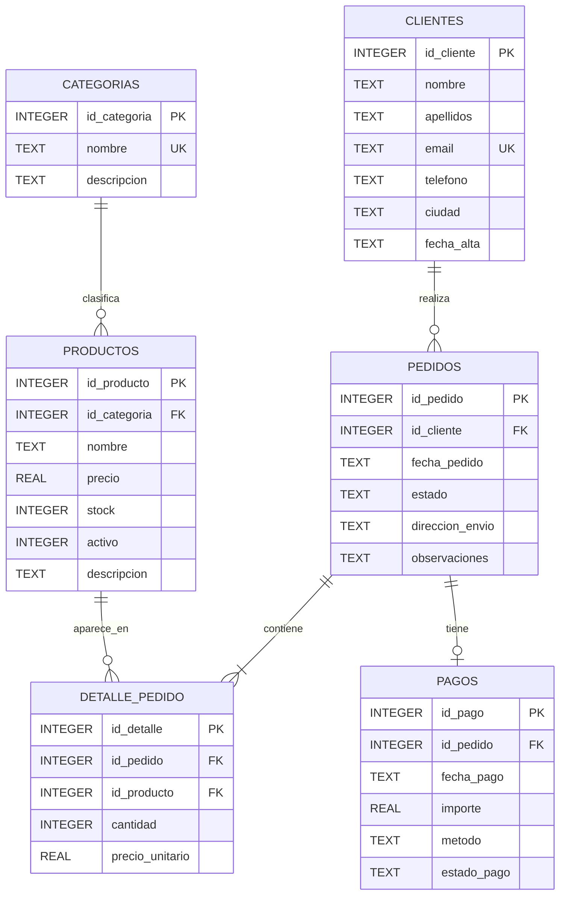

# Laboratorio de consultas SQL · 1.º DAM

📚 **Material didáctico | CFGS Desarrollo de Aplicaciones Multiplataforma**

**Curso:** 1.º DAM  
**Módulo:** Programación  
**Profesor y autor:** Christian Bihurriet  
**Centro educativo:** CESUR

Repositorio de material docente elaborado para la enseñanza de la programación en el Ciclo Formativo de Grado Superior en Desarrollo de Aplicaciones Multiplataforma (DAM). Incluye explicaciones, ejemplos progresivos y ejercicios diseñados para estudiantes que están aprendiendo a programar.

Repositorio para aprender a consultar una tienda online ficticia con SQLite y Visual Studio Code. La primera práctica empieza por leer una tabla; las unidades siguientes irán añadiendo filtros, ordenación y relaciones.

## Empezar en clase

1. Clona el repositorio y abre su carpeta en VS Code.
2. Instala la extensión recomendada **SQLite IntelliView**. La recomendación incluida usa el identificador oficial `Bowlerr.sqlite-intelliview-vscode`.
3. Abre `datos/tienda.db`; si VS Code lo pregunta, selecciona **Open With… > SQLite Database IntelliView**.
4. Explora las pestañas **Data** (filas), **Schema** (columnas y claves), **Query** (consultas) y **Diagram** (relaciones).
5. Empieza por [01_select](01_select/README.md). Copia y ejecuta las consultas en IntelliView.

No necesitas instalar Python, un servidor ni otro gestor de bases de datos para usar el laboratorio. La base ya está creada. Trabajaremos inicialmente solo con consultas de lectura: no edites la copia compartida ni des por hecho que la extensión guardará modificaciones.

## Diagrama de la tienda

## Contenido

| Unidad | Tema | Estado |
|---|---|---|
| 01_select | Elegir tablas, columnas y alias | Disponible |
| 02_filtros | `WHERE` y operadores lógicos | Disponible |
| 03_ordenacion | Ordenación, búsqueda y resultados distintos | Disponible |
| 04_agregaciones | Funciones de resumen | Disponible |
| 05_group_by | Agrupar resultados | Disponible |
| 06_joins | Relacionar tablas | Disponible |
| 07_subconsultas | Consultas dentro de consultas | Disponible |
| 08_conjuntos | Combinar varios resultados | Disponible |
| 09_optimizacion | Leer y mejorar consultas | Disponible |

## Cómo practicar

Cada unidad contiene una explicación breve, ejemplos que se pueden ejecutar y una batería de ejercicios. La repetición es intencional: empieza con enunciados muy guiados, continúa con situaciones que indican la información necesaria y termina con retos más autónomos. No hay soluciones incluidas.

El itinerario desarrolla el bloque de consultas del resultado de aprendizaje 3 del módulo profesional 0484: consultas sobre una y varias tablas, composiciones internas y externas, resumen, subconsultas, múltiples selecciones y criterios de optimización. 

## Sobre este repositorio

Este proyecto forma parte de una colección de recursos educativos desarrollados por Christian Bihurriet para sus clases del módulo de Programación en el Ciclo Formativo de Grado Superior en Desarrollo de Aplicaciones Multiplataforma.

El código está adaptado deliberadamente al nivel del alumnado y prioriza la claridad didáctica sobre la complejidad técnica.
